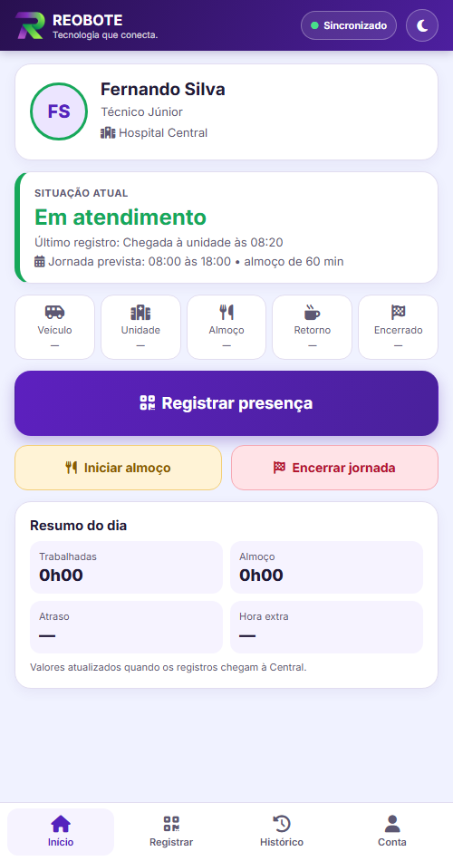
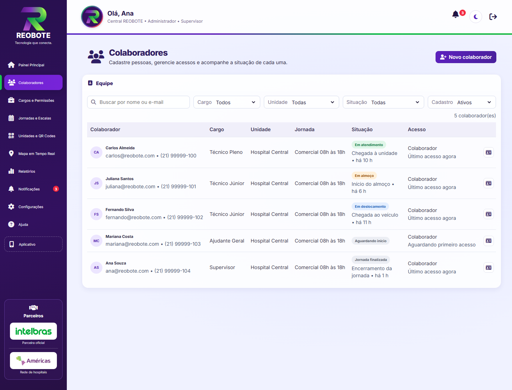
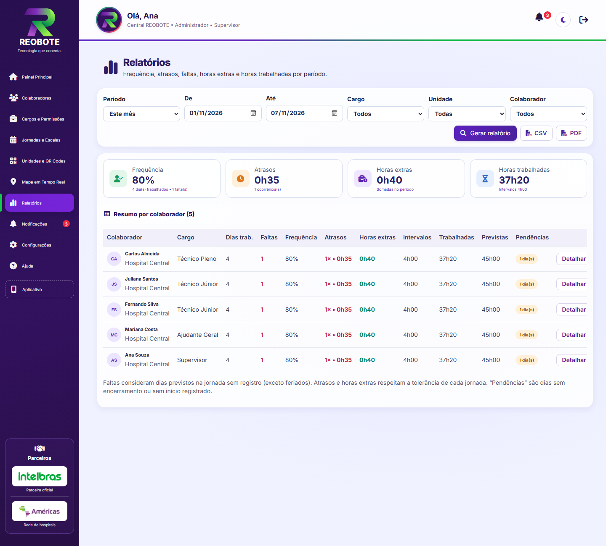
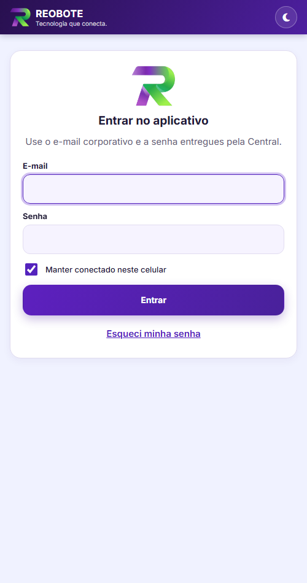

<!-- REOBOTE | README.md — Apresentação do projeto, link do APK, como rodar e organização -->
<div align="center">

# REOBOTE — Tecnologia que conecta.

**Controle de jornada por QR Code para equipes técnicas em campo.**
O técnico registra o ponto pelo celular, mesmo sem internet, e a gestão acompanha tudo em tempo real.


**[⬇️ Baixar o APK para Android](https://github.com/viinisilvaa/Reobote/releases/latest/download/reobote.apk)** · [Guia completo](docs/GUIA.md)

</div>

---

## Sumário

- [Telas](#telas)
- [O que o sistema faz](#o-que-o-sistema-faz)
- [Segurança e privacidade](#segurança-e-privacidade)
- [Como rodar](#como-rodar)
- [Organização das pastas](#organização-das-pastas)
- [Tecnologias](#tecnologias)

## Telas

| Central: painel | Central: mapa em tempo real | Aplicativo |
| --- | --- | --- |
|  |  |  |
| **Central: colaboradores** | **Central: relatórios** | **Aplicativo: login** |
|  |  |  |

## O que o sistema faz

### 📱 Aplicativo do colaborador (Android e navegador)
- Registro de chegada no **veículo** e na **unidade** lendo o QR Code com a câmera; ler de novo o QR da unidade registra a **saída**.
- Início e fim do **almoço**, encerramento da jornada e **histórico** com horas trabalhadas e valor ganho.
- **Funciona sem internet**: guarda os registros com o horário original e envia sozinho quando a conexão volta.
- Localização (GPS) só **durante a jornada**, com autorização, inclusive com a tela apagada no APK.
- Detecção de **GPS falso**.

### 🖥️ Central (painel administrativo)
- **Painel** com ativos, atrasados, ausentes, em almoço e horas extras.
- **Mapa em tempo real** (OpenStreetMap, sem custo): técnicos nas unidades e em deslocamento, com opção de seguir cada um.
- **Notificações** no sino (estilo Facebook) e avisos em tempo real; aviso ao responsável da unidade pelo **WhatsApp**.
- **Colaboradores** com foto, **cargos** com permissões, **jornadas e escalas** (tolerância, 12x36, turnos noturnos, feriados).
- Justificativa de faltas e atrasos, **lançamento manual** e anulação de registros, sempre com histórico de alterações.
- **Relatórios** em PDF e CSV, geração de **QR Codes** para impressão, tema claro e escuro.

## Segurança e privacidade

| Proteção | Como funciona |
| --- | --- |
| 🔐 Senhas | Guardadas só como hash; ninguém, nem a administração, vê a senha. |
| 🚫 Tentativas de login | **5 senhas erradas** bloqueiam a conta por 15 minutos; também há limite por IP. |
| 🤖 Robôs | Campo-armadilha invisível no login e no "Esqueci minha senha". |
| 🔒 Dados sensíveis | **Salário e telefones criptografados** no banco (AES-256-GCM). |
| 🍪 Sessão | Cookie `HttpOnly` e `SameSite`; sessão renovada a cada login. |
| 🌐 HTTPS e cabeçalhos | HTTPS forçado pela internet, HSTS, CSP e outros cabeçalhos de segurança. |
| 🗂️ Arquivos internos | `php/`, `.env`, fotos e logs nunca são entregues ao navegador (respondem 404). |
| 📤 Uploads | Só imagens JPG, PNG ou WEBP, com tamanho máximo, regravadas sem metadados. |
| 👁️ Permissões | Conferidas no servidor a cada pedido, conforme o perfil e o cargo. |
| 📜 LGPD | Página de [privacidade e cookies](central/html/privacidade.html) e só cookies necessários. |
| 📦 Dependências | Dependabot avisa sobre falhas conhecidas nas bibliotecas do APK. |

## Como rodar

**Requisitos:** [XAMPP](https://www.apachefriends.org/) (Apache + PHP 8.1 ou superior + MySQL/MariaDB).

1. Coloque o projeto em `C:\xampp\htdocs\Reobote`.
2. Copie `.env.example` para `php/.env` e preencha o usuário e a senha do banco e o `SESSION_SECRET`.
3. Crie o banco e as tabelas:
   ```bash
   php php/setup.php
   ```
   O setup também cria a `DATA_KEY`, a chave que criptografa os dados sensíveis. **Guarde uma cópia do `php/.env`**: sem ela, esses dados não podem ser lidos.
4. Crie o primeiro administrador:
   ```bash
   php php/create-user.php
   ```
5. Coloque o REOBOTE na porta 3000 do Apache (veja [Rodar no XAMPP](docs/GUIA.md#rodar-no-xampp-windows)) ou, para um teste rápido, use o servidor do PHP:
   ```bash
   php -S 127.0.0.1:3000 php/router.php
   ```
6. Abra **http://localhost:3000/central/** (Central) ou **http://localhost:3000/app/** (aplicativo).

Para acessar de fora do Wi-Fi, dê dois cliques em **`Ligar REOBOTE na internet.bat`** (túnel gratuito da Cloudflare). O passo a passo completo, incluindo o APK, está no [Guia completo](docs/GUIA.md).

## Organização das pastas

```
Reobote/
├── central/            Central (painel administrativo)
│   ├── html/           páginas: entrar, painel, colaboradores, mapa... + 404 e privacidade
│   ├── css/            estilos (base, componentes, tema escuro e de cada página)
│   ├── js/             app-core.js (sessão, menu, notificações) e um módulo por página
│   └── assets/         logotipos dos parceiros
├── app/                Aplicativo do colaborador (navegador e APK)
│   ├── html/           index.html (tela única)
│   ├── css/  js/       estilos, lógica e fila offline
│   └── sw.js           funcionamento sem internet
├── compartilhado/      cliente da API, tema e logotipo (usados pelas duas partes)
├── php/                todo o PHP: API, rotas, regras de jornada, setup e .env
├── aplicativo-android/ projeto que transforma o app em APK (Capacitor)
├── ferramentas/        ligar o REOBOTE na internet (túnel)
└── docs/               guia completo e capturas de tela
```

As páginas ficam em `html/`, mas os endereços continuam simples (`/central/entrar.html`, `/app/`): o `.htaccess` e o `php/router.php` buscam o arquivo na pasta certa.

## Tecnologias

HTML, CSS e JavaScript puros · PHP 8 com MySQL/MariaDB · Leaflet + OpenStreetMap · Capacitor (APK Android) · GitHub Actions (APK e Central publicados automaticamente) · Cloudflare Tunnel
