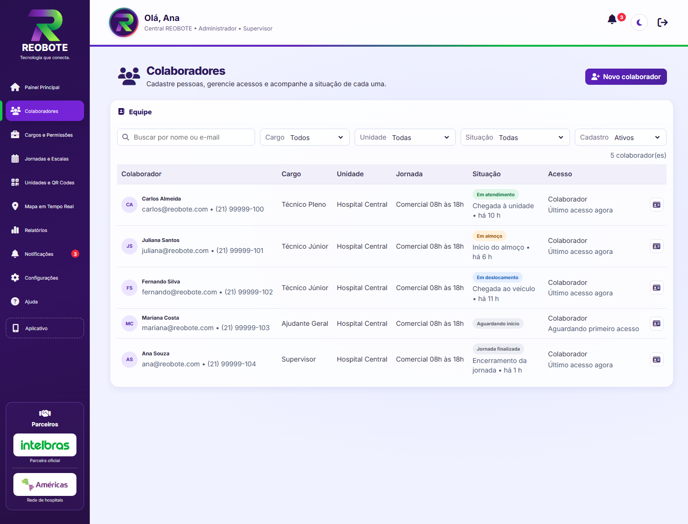
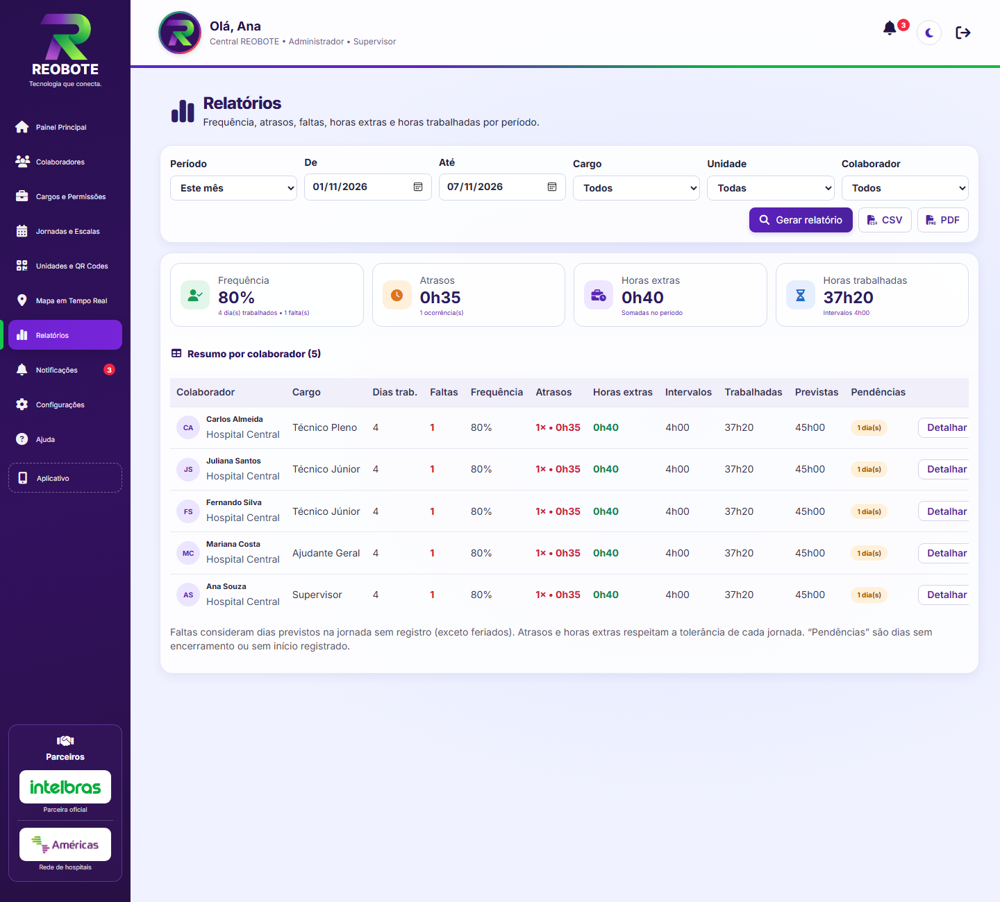
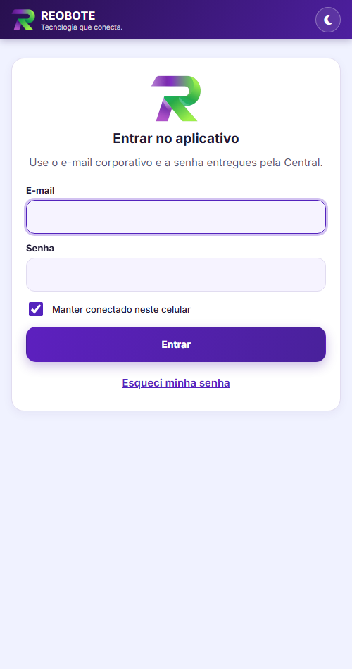
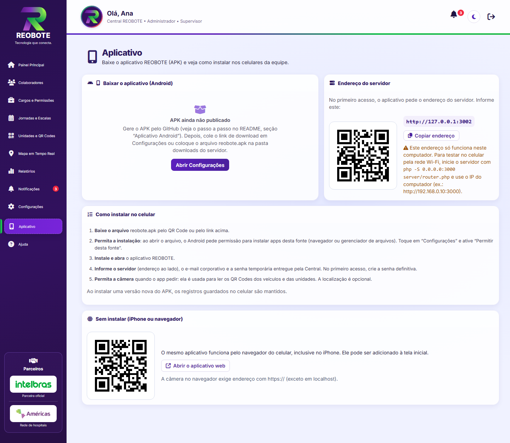

# REOBOTE — Tecnologia que conecta.


Plataforma de **controle de jornada por QR Code** para equipes técnicas que trabalham em campo, como técnicos que vão de veículo até hospitais e unidades de atendimento. O colaborador registra o ponto pelo celular, mesmo sem internet, e a gestão acompanha tudo em tempo real num painel web.

O sistema tem duas partes, que usam o mesmo banco de dados e a mesma API:

- **Aplicativo REOBOTE** (pasta `app/`, endereço `/app/`, também como APK Android): usado pelos colaboradores no celular. Permite registrar a chegada ao veículo e à unidade por QR Code, registrar o almoço e o encerramento, consultar o histórico e compartilhar a localização com consentimento. Funciona sem internet.
- **Central REOBOTE** (pasta `central/`, endereço `/central/`): o painel administrativo. Reúne indicadores, colaboradores, cargos e permissões, jornadas e escalas, unidades e QR Codes, mapa, notificações, relatórios (CSV/PDF), configurações e auditoria.

## Telas

| Central: painel principal | Central: mapa em tempo real |
| --- | --- |
|  |  |
| **Central: colaboradores** | **Central: relatórios** |
|  |  |

| Aplicativo: login | Aplicativo: início | Central: download do APK |
| --- | --- | --- |
|  |  |  |

> As telas usam dados de demonstração.

## Destaques técnicos

- **Sem frameworks:** HTML, CSS e JavaScript puros no front-end, e PHP com PDO no back-end, como pedia o projeto.
- **Motor de jornada no servidor** (`server/lib/journey.php`): agrupa os registros em turnos, inclusive turnos que atravessam a meia-noite, e calcula atraso, horas extras e faltas. Considera tolerância, escala 12x36, folgas e feriados. Tem 29 testes automatizados.
- **Funciona sem internet:** cada registro recebe um identificador único e o horário original, corrigido pela diferença de relógio com o servidor. Quando a conexão volta, o servidor sincroniza os registros sem duplicar.
- **Leitura de QR Code** pela câmera, com `BarcodeDetector` ou `jsQR` quando ele não existe. Os QR Codes das unidades e dos veículos são gerados e impressos pela Central.
- **Segurança e LGPD:** sessão em cookie `HttpOnly`, proteção contra CSRF, limite de tentativas de login, permissões verificadas no servidor a cada requisição, fotos fora da pasta pública, localização só com consentimento e histórico de auditoria. Registros de ponto nunca são apagados.
- **APK Android gerado na nuvem:** o Capacitor empacota o app e o GitHub Actions compila o APK a cada atualização.
- **Código comentado em português**, do servidor aos estilos.

## Instalação

1. Instale o PHP 8.1 ou superior com as extensões `pdo_mysql` e `mbstring`, e de preferência também a `gd` (ela redimensiona as fotos e remove os metadados delas). Instale também o MySQL 8 ou o MariaDB 10.6 ou superior.
2. Copie `.env.example` para `server/.env` e preencha os dados do banco e o `SESSION_SECRET`, que precisa de pelo menos 32 caracteres aleatórios.
3. Execute `php server/setup.php`. Ele cria ou atualiza o banco sem apagar dados. O mesmo comando também cria as jornadas e os cargos iniciais (Ajudante Geral, Técnico Júnior, Técnico Pleno e Supervisor) e os feriados nacionais fixos. Pode ser executado de novo depois de cada atualização do sistema.
4. Crie o primeiro administrador com `php server/create-user.php`. As demais contas são criadas pela Central, em **Colaboradores**.
5. Para testar localmente, rode `php -S 127.0.0.1:3000 server/router.php` e acesse `http://localhost:3000/central/` (Central) ou `http://localhost:3000/app/` (aplicativo).
6. Em produção, use **HTTPS** com Apache e os módulos `mod_rewrite` e `mod_headers` (o `.htaccess` já está pronto). A câmera, o GPS e a instalação do aplicativo só funcionam em HTTPS, com exceção do `localhost`.
7. O mapa é opcional. Para usá-lo, ative a Maps JavaScript API no Google Cloud, restrinja a chave por referenciador HTTP e coloque-a em `GOOGLE_MAPS_BROWSER_KEY`.

Faça backup diário do banco (`mysqldump`) e da pasta `server/storage`, que guarda as fotos.

## Aplicativo Android (APK)

O APK é gerado automaticamente na nuvem do GitHub, de graça. Não é preciso instalar nada no computador. Ele contém o mesmo aplicativo da pasta `app/`, com câmera para os QR Codes, funcionamento sem internet e login próprio. No primeiro acesso, o celular pede o **endereço do servidor**.

### Gerar o APK (uma vez, e de novo a cada atualização do app)

1. Crie uma conta em https://github.com, se ainda não tiver.
2. Instale o **GitHub Desktop** (https://desktop.github.com) e entre com a sua conta.
3. No GitHub Desktop, use **File > Add local repository** e escolha a pasta `Reobote`. Ele vai avisar que a pasta não é um repositório: clique em **create a repository** e depois em **Create repository**.
4. Clique em **Publish repository**. Pode deixar o repositório como privado. O arquivo `server/.env`, que tem as senhas, **não** é enviado, porque está no `.gitignore`.
5. No site do GitHub, abra o repositório e vá em **Actions**. A automação **Gerar APK do aplicativo** começa sozinha e leva uns 5 minutos. Se ela não aparecer, clique nela e depois em **Run workflow**.
6. Quando terminar, o arquivo `reobote.apk` aparece em **Releases**, na coluna da direita da página do repositório.

Cada vez que você alterar o aplicativo e enviar pelo GitHub Desktop (**Commit** e depois **Push**), um APK novo é gerado. Ele instala por cima do anterior sem perder os registros guardados no celular.

### Disponibilizar para os colaboradores

Escolha uma das opções:

- **Pelo próprio servidor (recomendado com repositório privado):** baixe o `reobote.apk` em Releases e coloque o arquivo na pasta `downloads/` do servidor.
- **Pelo link do GitHub (somente repositório público):** em Central > Configurações > **Link de download do APK**, cole `https://github.com/USUARIO/REPOSITORIO/releases/latest/download/reobote.apk`.

Depois disso, a página **Aplicativo** da Central (no menu lateral) mostra o botão de download, um **QR Code para baixar pelo celular**, o endereço do servidor (também em QR Code) e o passo a passo de instalação.

### Testar no celular antes de ter um servidor na internet

1. Inicie o servidor aceitando conexões da rede: `php -S 0.0.0.0:3000 server/router.php`.
2. Descubra o IP do computador. No Windows, rode `ipconfig` e anote o "Endereço IPv4", por exemplo `192.168.0.10`.
3. No app, informe o servidor `http://192.168.0.10:3000`. O celular precisa estar no mesmo Wi-Fi. Se não conectar, libere a porta 3000 no Firewall do Windows.

Em produção, use um endereço com `https://`.

### Alternativa: gerar no próprio computador

Com Node.js 20, Java 17 e Android Studio instalados, rode dentro de `aplicativo-android/`: `npm install`, `npm run preparar`, `npx cap add android`, `npm run android:configurar`, `npx cap sync android` e, por fim, `npx cap open android`. No Android Studio, use **Build > Build APK(s)**.

## Como funciona na prática

1. Em **Unidades e QR Codes**, cadastre os hospitais e locais de atendimento. Cada unidade recebe um QR Code automaticamente. Gere também os QR Codes dos veículos e imprima as etiquetas.
2. Em **Jornadas e Escalas**, configure os horários: entrada, saída, intervalo de almoço, dias da semana ou escala em ciclo (12x36), tolerância de atraso (15 min por padrão) e se o trabalho em folgas e feriados conta como hora extra.
3. Em **Cargos e Permissões**, defina o que cada cargo pode acessar e qual é a jornada padrão dele.
4. Em **Colaboradores**, cadastre a pessoa com foto, e-mail corporativo, cargo, unidade e, se for o caso, uma jornada individual. O sistema mostra uma **senha temporária** uma única vez. No primeiro acesso, o colaborador é obrigado a criar a própria senha.
5. O colaborador abre o aplicativo, toca em **Registrar presença** e lê o QR Code do veículo e depois o da unidade. Ao longo do dia, usa **Iniciar almoço**, **Retornar do almoço** e **Encerrar jornada**.
6. A Central recebe os registros: o painel, o mapa, as notificações e os relatórios se atualizam sozinhos.

### Regras de jornada (calculadas no servidor, em `server/lib/journey.php`)

- **Turno**: começa na primeira leitura de QR Code e termina no encerramento. Turnos que atravessam a meia-noite contam para o dia em que começaram. Se o colaborador esquecer de encerrar, o turno é fechado depois do intervalo configurado (16 h por padrão) e aparece como pendência.
- **Atraso**: diferença entre o primeiro registro do dia e a entrada prevista. Só é contado quando passa da tolerância.
- **Horas extras**: horas trabalhadas, já descontado o almoço, que passam das previstas e da tolerância. Em folgas e feriados, as horas contam inteiras como extras se a jornada estiver configurada assim.
- **Falta**: dia de trabalho previsto, fora de feriado, sem nenhum registro.
- **Sequência**: o sistema recusa registros fora de ordem, como encerrar durante o almoço, e ignora leituras repetidas em menos de 2 minutos.

### Funcionamento sem internet

O aplicativo guarda cada registro no celular com o **horário original**, já corrigido pela diferença entre o relógio do aparelho e o do servidor, e um identificador único. Quando a conexão volta, ele envia os registros em ordem cronológica e o servidor descarta duplicados. Na Central, esses registros aparecem como "sincronizado depois". Registros mais antigos que o prazo configurado (7 dias por padrão) são recusados. Um service worker (`app/sw.js`) mantém as telas do aplicativo disponíveis sem conexão.

### Segurança e LGPD

- A sessão usa cookie `HttpOnly`, e as senhas são guardadas com hash. As operações de escrita exigem a mesma origem e o cabeçalho `X-Reobote`. O login tem limite de tentativas.
- As permissões são verificadas no servidor a cada requisição, conforme o perfil da conta (Administrador, Gestor ou Colaborador) e as permissões do cargo. Desativar um cadastro bloqueia o acesso na hora.
- As fotos ficam fora da pasta pública (`server/storage/photos`) e só são entregues a quem pode ver o colaborador.
- A localização contínua só é coletada com o consentimento do próprio colaborador, que pode revogá-lo, e fica guardada por 30 dias.
- Registros de ponto nunca são apagados. Uma correção é feita por **lançamento manual** ou por **anulação**, sempre com justificativa, e fica no **histórico de alterações** (Configurações).
- Recuperação de acesso: pela opção "Esqueci minha senha", a administração recebe um aviso e gera uma nova senha temporária.

## Organização do código

A Central e o aplicativo ficam em pastas separadas. Cada um tem as próprias páginas, estilos, scripts e tela de login:

```
central/          Central REOBOTE (painel administrativo)
  *.html          uma página por área (entrar, painel-principal, colaboradores, cargos, jornadas, unidades, ...)
  css/            design.css e theme.css (base e tema escuro), components.css e estilos de cada página
  js/             app-core.js (sessão, menu por permissões, diálogos) e um módulo por página
  js/vendor/      qrcode-generator (gera os QR Codes para impressão)
  assets/         logotipos dos parceiros
app/              Aplicativo REOBOTE do colaborador (PWA)
  index.html      tela única: login, início, registro por QR Code, histórico e conta
  css/app.css     estilos do aplicativo
  js/app.js       lógica do aplicativo e fila offline
  js/vendor/      jsQR (leitura de QR Code pela câmera)
  icons/          ícones de instalação
  manifest.webmanifest e sw.js (instalação e funcionamento sem internet)
compartilhado/    o mínimo usado pelas duas partes
  js/api-client.js  comunicação com a API
  js/theme.js       tema claro/escuro
  assets/           logotipo REOBOTE
aplicativo-android/  projeto que transforma a pasta app/ em APK Android (Capacitor)
  package.json, capacitor.config.json, scripts/ e LEIA-ME.md (explica cada configuração)
.github/workflows/gerar-apk.yml  automação do GitHub que compila e publica o APK
downloads/        coloque aqui o reobote.apk para ser baixado pelo servidor
docs/capturas/    imagens das telas usadas neste README
server/           API PHP: api.php, routes/, lib/ (autenticação, motor de jornada, notificações), setup.php e create-user.php
```
## Principais rotas da API

| Área | Rotas |
| --- | --- |
| Sessão | `POST /api/auth/login`, `GET /api/auth/me`, `POST /api/auth/logout`, `POST /api/auth/change-password`, `POST /api/auth/forgot` |
| Aplicativo | `GET /api/me/today`, `POST /api/me/attendance` (lote, offline), `GET /api/me/history`, `PUT /api/me/location-sharing`, `POST /api/me/locations` |
| Colaboradores | `GET/POST /api/employees`, `GET/PUT /api/employees/:id`, `POST /api/employees/:id/reset-password`, `GET/POST/DELETE /api/employees/:id/photo`, `GET /api/employees/:id/profile`, `GET/POST /api/employees/:id/attendance`, `POST /api/attendance/:id/void` |
| Cadastros | `/api/jobs`, `/api/schedules`, `/api/holidays`, `/api/units`, `/api/qr-codes` (+ `/regenerate`), `GET /api/permissions` |
| Central | `GET /api/dashboard`, `GET /api/map`, `GET /api/notifications`, `GET /api/notifications/count`, `POST /api/notifications/read`, `GET /api/reports`, `GET/PUT /api/settings`, `GET /api/audit` |
