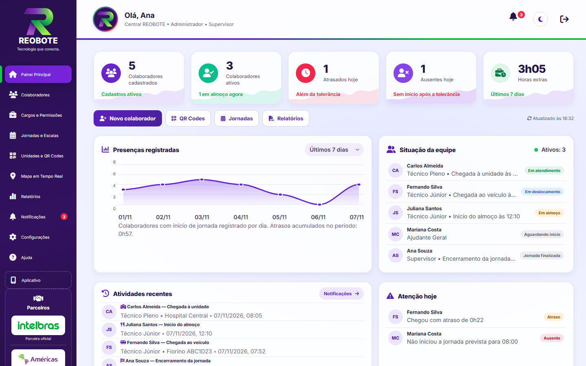
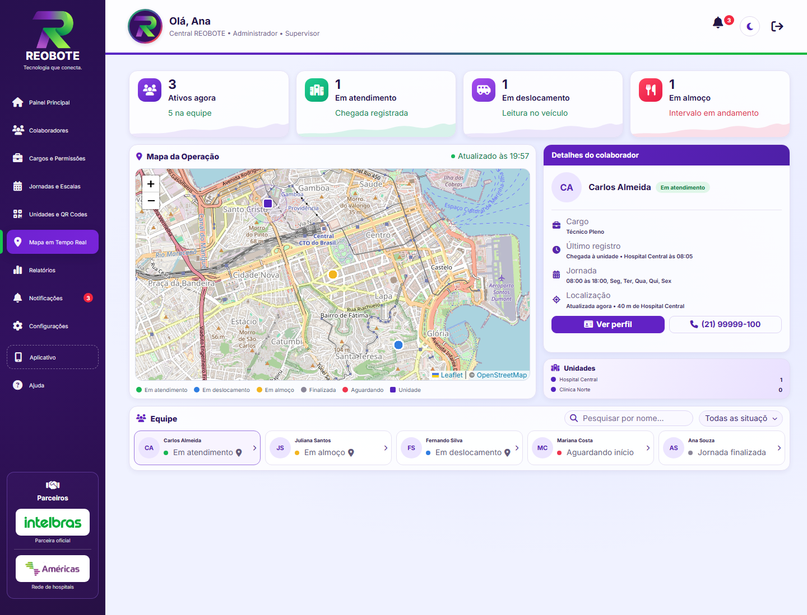
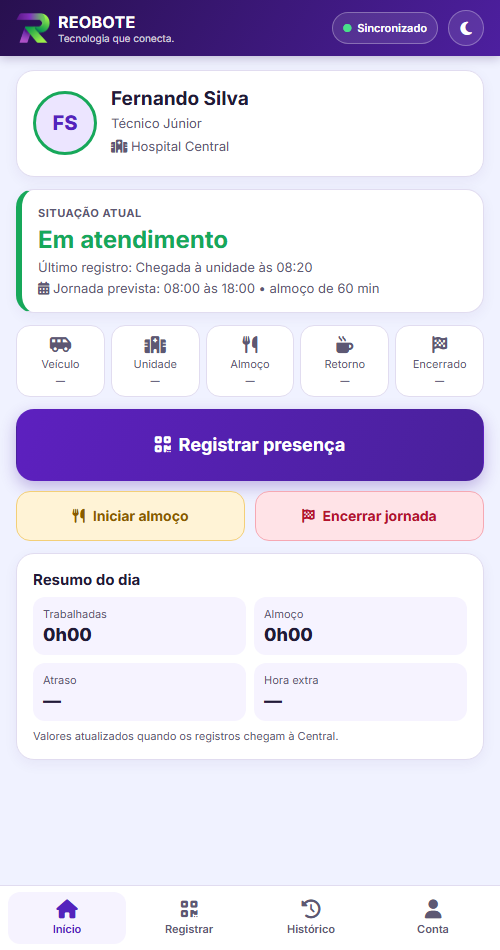

# REOBOTE — Tecnologia que conecta.


Sistema de **controle de jornada por QR Code** para equipes técnicas em campo. O técnico registra o ponto pelo celular, mesmo sem internet, e a gestão acompanha tudo em tempo real.

## 📱 Baixar o aplicativo

**[⬇️ Baixar o APK para Android](https://github.com/viinisilvaa/Reobote/releases/latest/download/reobote.apk)**

Depois de instalar, entre com o e-mail e a senha temporária entregue pela Central.

## Telas

| Central: painel | Central: mapa em tempo real | Aplicativo |
| --- | --- | --- |
|  |  |  |

## O que o sistema faz

**Aplicativo do colaborador**
- Registro de chegada no veículo e na unidade lendo o QR Code com a câmera
- Início e fim do almoço, encerramento da jornada e histórico
- Funciona sem internet e envia os registros com o horário original quando a conexão volta

**Central (painel administrativo)**
- Painel com ativos, atrasados, ausentes e horas extras
- Mapa em tempo real com a localização dos técnicos (OpenStreetMap, sem custo)
- Colaboradores com foto, cargos com permissões, jornadas e escalas (tolerância, 12x36, feriados)
- Notificações, relatórios em PDF/CSV e geração de QR Codes

## Tecnologias

HTML, CSS e JavaScript puros · PHP 8 com MySQL · Capacitor (APK Android) · GitHub Actions

## Como rodar

```bash
cp .env.example server/.env     # preencha os dados do banco
php server/setup.php            # cria as tabelas
php server/create-user.php      # cria o primeiro administrador
php -S 127.0.0.1:3000 server/router.php
```

Acesse `http://localhost:3000/central/` (Central) ou `http://localhost:3000/app/` (aplicativo).

📖 Instalação em produção, mapa, geração do APK e regras de jornada: **[Guia completo](docs/GUIA.md)**.
