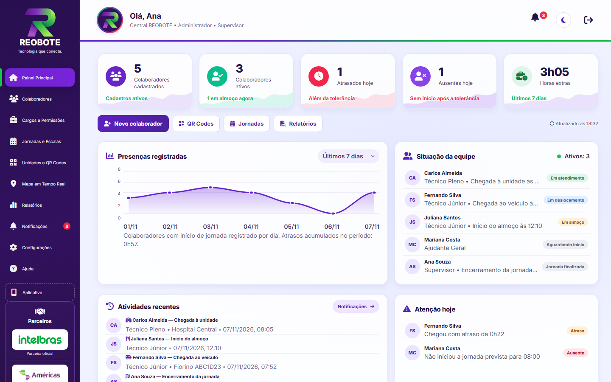
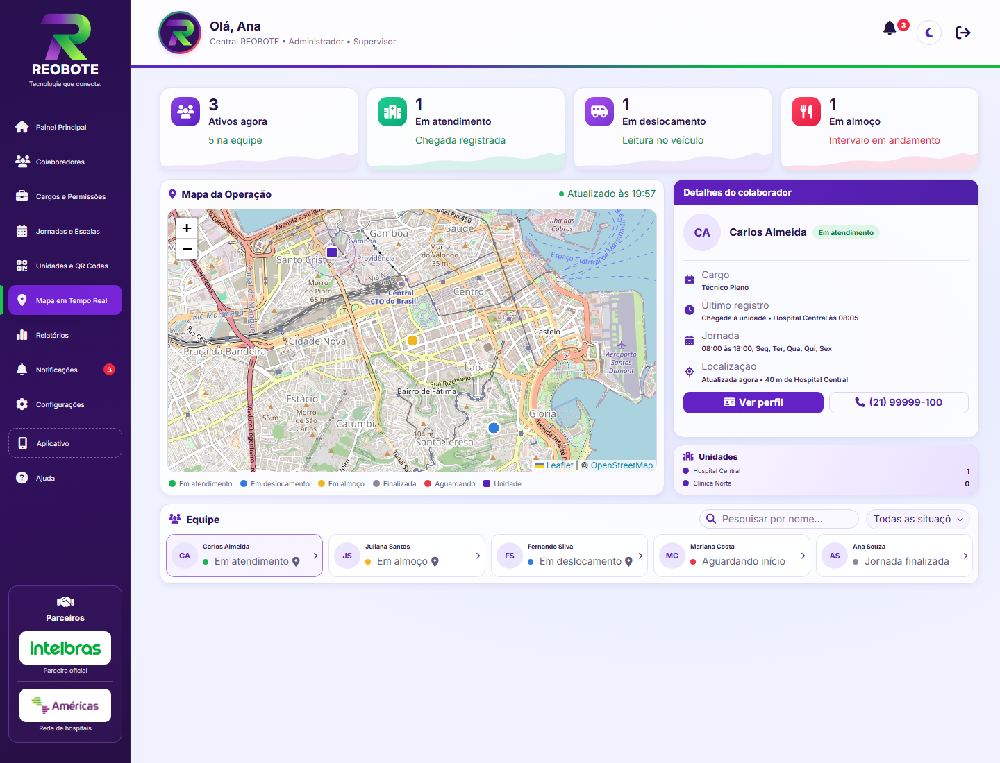

<!-- REOBOTE | README.md — Apresentação do projeto, link do APK e onde encontrar o guia -->

# REOBOTE — Tecnologia que conecta.

Controle de jornada por QR Code para equipes técnicas em campo. 
O técnico registra o ponto pelo celular, mesmo sem internet, e a gestão acompanha tudo em tempo real.

**[⬇️ Baixar o APK para Android](https://github.com/viinisilvaa/Reobote/releases/latest/download/reobote.apk)** · **[📖 Guia completo](docs/GUIA.md)**

## Telas

| Central | Mapa em tempo real | Aplicativo |
| --- | --- | --- |
|  |  |  |

## Principais recursos

- **Aplicativo:** ponto por QR Code, almoço, histórico e funcionamento sem internet.
- **Central:** painel da equipe, mapa em tempo real, notificações, relatórios em PDF e QR Codes.
- **Segurança:** dados sensíveis criptografados, bloqueio após 5 senhas erradas e adequado à LGPD.

## Como rodar

Com o [XAMPP](https://www.apachefriends.org/) instalado, coloque o projeto em `C:\xampp\htdocs\Reobote` e siga a [instalação no Guia completo](docs/GUIA.md#instalação). Depois, abra **http://localhost:3000/central/**.

---

HTML, CSS e JavaScript · PHP 8 · MySQL · Capacitor (Android)

